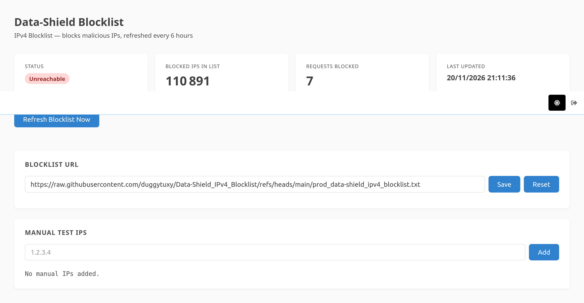

# zoraxy-datashield-blocklist

A [Zoraxy](https://zoraxy.aroz.org/) plugin that blocks incoming connections from IPs listed in the [Data-Shield IPv4 Blocklist](https://github.com/duggytuxy/Data-Shield_IPv4_Blocklist) — roughly 100,000 known-malicious IPv4 addresses, refreshed automatically every 6 hours.



## Features

- Blocks ~100k threat IPs from the Data-Shield list with sub-millisecond overhead per request
- Auto-refreshes the blocklist every 6 hours (no restart needed)
- Manual blocklist: add or remove individual IPs from the Zoraxy plugin UI
- Private/loopback/link-local addresses are never blocked regardless of the list
- IPv6 traffic passes through unaffected (the Data-Shield list is IPv4-only)
- Displays live stats: IPs loaded, last update time, total blocked requests
- Configurable blocklist URL — change the source directly from the plugin UI; persisted in `config.json` next to the binary

## Requirements

- [Zoraxy](https://zoraxy.aroz.org/) with plugin support enabled
- Go 1.24+ (to build from source)

## Installation

### From source

```bash
git clone https://github.com/kianby/zoraxy-datashield-blocklist.git
cd zoraxy-datashield-blocklist
go build -o datashield-blocklist .
```

Then copy the binary into Zoraxy's plugin directory:

```bash
cp datashield-blocklist /path/to/zoraxy/plugins/datashield-blocklist/
```

Restart Zoraxy — the plugin will appear in the Plugins section of the admin UI.

### Pre-built binary

Download the latest release binary for your platform and place it in Zoraxy's `plugins/datashield-blocklist/` directory, then restart Zoraxy.

## Usage

Once installed and enabled in Zoraxy, the plugin works automatically. You can view its status and manage manual overrides through the plugin's UI in the Zoraxy admin panel.

### Manual IP management

In the plugin UI you can:
- **Add an IP** to immediately block a specific IPv4 address (takes effect instantly, no restart needed)
- **Remove an IP** to unblock a manually-added address
- **Force refresh** to re-download the Data-Shield blocklist on demand

> **Note:** Manually added IPs are held in memory only. They are cleared when the plugin or Zoraxy restarts.

### Changing the blocklist URL

The plugin fetches the Data-Shield list from a default URL that can be overridden directly in the UI:

1. In the **Blocklist URL** field, enter any `http://` or `https://` URL pointing to a plain-text file with one IPv4 address per line.
2. Click **Save** — the new URL is saved to `config.json` next to the plugin binary and a refresh is triggered immediately.
3. Click **Reset** to revert to the built-in default URL.

> **Note:** The plugin requires at least 1,000 valid IPv4 entries in the downloaded file before replacing the active blocklist. This prevents an accidental empty list (or an HTTP error page) from leaving the plugin unprotected.

### What gets blocked

When a blocked IP connects, Zoraxy routes the request through this plugin's capture handler, which returns a `403 Forbidden` response. The connection is dropped before it reaches any proxied backend.

### What is never blocked

- IPv6 addresses (the Data-Shield list covers IPv4 only)
- Private ranges: `10.0.0.0/8`, `172.16.0.0/12`, `192.168.0.0/16`
- Loopback: `127.0.0.0/8`
- Link-local: `169.254.0.0/16`
- Carrier-grade NAT: `100.64.0.0/10`

## Blocklist source

This plugin uses the full [Data-Shield IPv4 Blocklist](https://github.com/duggytuxy/Data-Shield_IPv4_Blocklist) maintained by [@duggytuxy](https://github.com/duggytuxy). The URL can be changed from the plugin UI (saved in `config.json` next to the binary), and defaults to the full list. The list targets scanners, botnets, and other high-confidence threat sources.

Example `config.json`:

```json
{
  "blocklist_url": "https://raw.githubusercontent.com/duggytuxy/Data-Shield_IPv4_Blocklist/refs/heads/main/prod_data-shield_ipv4_blocklist.txt"
}
```

## License

See [LICENSE](LICENSE).
